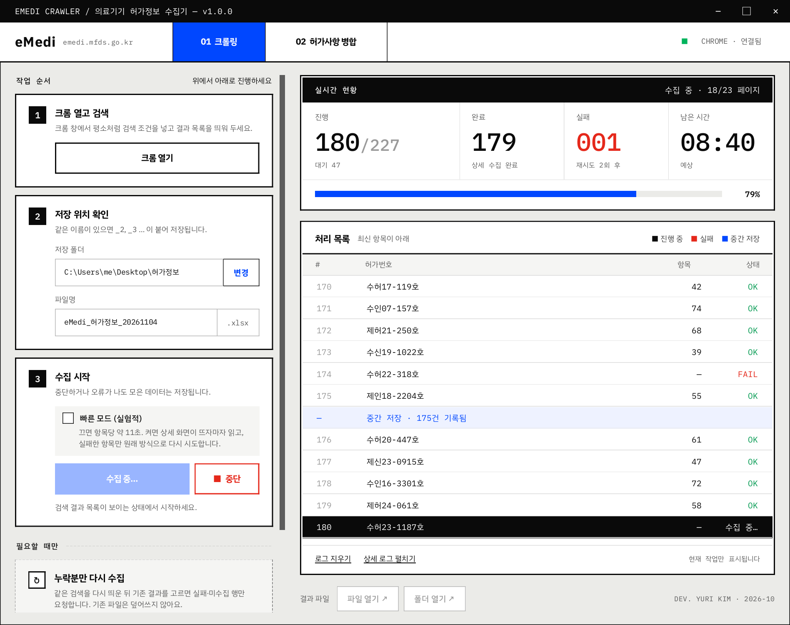
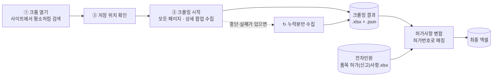
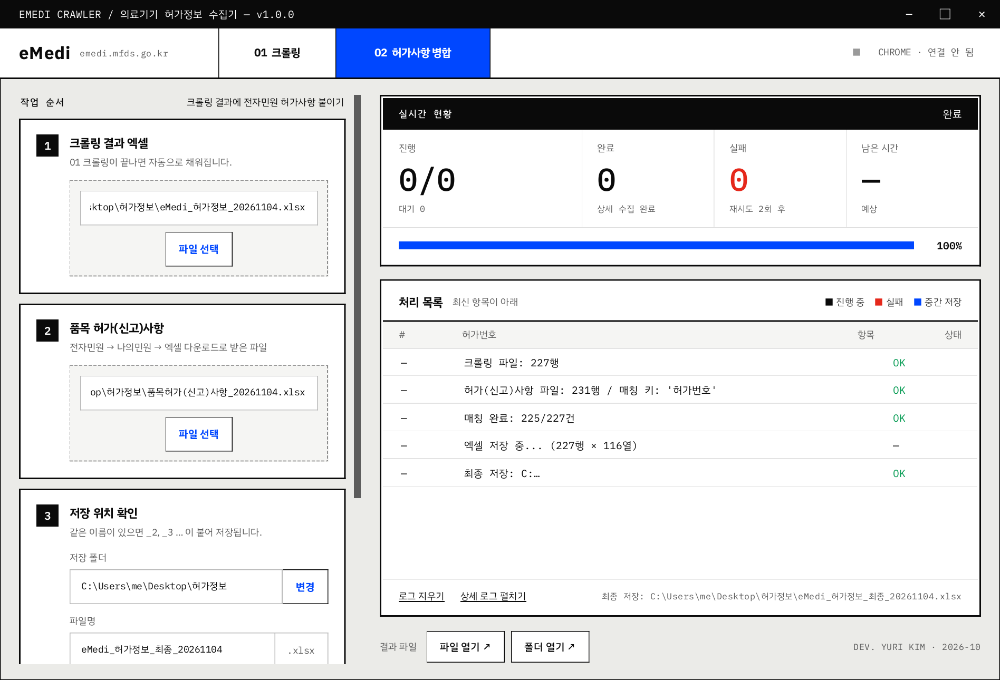

<p align="center">
  
</p>

<h1 align="center">eMedi Crawler</h1>

<p align="center">
  <b>의료기기 허가정보 수집기</b><br>
  Collects medical device permit details from <a href="https://emedi.mfds.go.kr">emedi.mfds.go.kr</a> into Excel, then merges in the 전자민원 permit list.
</p>

<p align="center">
  <a href="https://github.com/anoukkim/emedi-crawler/releases/latest"></a>
  
  
</p>

<p align="center">
  
</p>

## 설치 (Windows)

Python은 필요 없습니다. **Google Chrome**만 설치되어 있으면 됩니다.

1. **[Releases](https://github.com/anoukkim/emedi-crawler/releases/latest)** 에서 `eMediCrawler-vX.X.X-windows.zip` 을 받습니다.
2. 압축을 풉니다. 안에 있는 `eMediCrawler` **폴더 전체**를 원하는 곳(예: `문서`)에 둡니다. exe만 따로 꺼내면 실행되지 않습니다.
3. `eMediCrawler.exe` 를 실행합니다. 바탕화면 바로가기를 만들어 두면 편합니다 (우클릭 → 보내기 → 바탕 화면에 바로 가기 만들기).

> **"Windows의 PC 보호" 창이 뜨면** → **추가 정보** → **실행**을 누르세요. 회사 내부용으로 만든 앱이라 코드 서명이 없어서 나오는 안내입니다.
> 백신이 파일을 막거나 지우면 IT 담당자에게 `eMediCrawler.exe` 예외 등록을 요청하세요.

처음 실행할 때는 창이 뜨기까지 10초 정도 걸릴 수 있고, 처음 **크롬 열기**를 누를 때 크롬 드라이버를 자동으로 내려받으므로 인터넷이 필요합니다.

## 사용 방법



### 01 크롤링

1. **크롬 열기**를 누르면 검색 페이지가 열립니다. 평소처럼 검색 조건을 넣고 결과 목록을 띄워 둡니다.
2. 저장 폴더와 파일명을 확인합니다. 같은 이름이 있으면 `_2`, `_3` … 이 붙고, 기존 파일은 덮어쓰지 않습니다.
3. **크롤링 시작**을 누르면 모든 결과 페이지를 돌며 항목마다 상세 팝업을 열어 읽습니다. 오른쪽에서 진행 / 완료 / 실패 / 남은 시간과 항목별 결과를 볼 수 있습니다.

- 기본은 항목마다 10초를 기다린 뒤 읽는 검증된 방식입니다 (항목당 약 11초). **빠른 모드 (실험적)** 를 켜면 팝업이 뜨자마자 읽고, 실패한 항목만 원래 방식으로 다시 시도합니다.
- 실패한 항목은 최대 2회 재시도합니다. **중단**을 누르거나 오류가 나도 그때까지 모은 데이터는 저장됩니다.

### 누락분만 수집 (필요할 때만)

중단됐거나 실패한 항목이 있을 때 씁니다.

1. 크롬을 다시 열고 **처음과 같은 검색 조건**으로 검색합니다.
2. 기존 결과(`_partial.json`, 최종 `.json`, 또는 크롤링 `.xlsx`)를 고르고 **누락분만 수집**을 누릅니다.

이미 완료된 행은 그대로 두고 실패·목록만 있는·미수집 행만 다시 요청합니다. 결과는 번호가 붙은 새 Excel/JSON으로 저장되고, 진행 중에는 `_partial.json` 이 항목마다 갱신되므로 연결이 끊겨도 그 파일로 다시 이어갈 수 있습니다. 기존 행이 현재 검색 목록에 없으면 데이터를 잃지 않도록 멈춥니다.

> 예: 125행짜리 중간 파일에 완료 120행, 실패 5행이 있고 현재 검색 결과가 227건이면, 완료된 120행은 건너뛰고 나머지 107건만 수집합니다.

### 02 허가사항 병합

<p align="center">
  
</p>

1. **크롤링 결과 엑셀**: 크롤링이 끝나면 자동으로 채워집니다. 파일을 끌어다 놓아도 됩니다.
2. **품목 허가(신고)사항**: 전자민원 → 나의민원 → 엑셀 다운로드로 받은 파일.
3. 저장 위치를 확인하고 **파일 병합 시작**을 누르면, 허가번호로 매칭해 전자민원 열(`전자민원_…`)을 붙인 서식 있는 엑셀을 만듭니다.

끝나면 **파일 열기 / 폴더 열기**로 바로 결과를 열 수 있습니다.

### 결과 파일

- 목록 열 30개 + 상세 팝업의 제품정보·수입/제조업자·UDI·보험·기타정보 열.
- UDI 값은 쉼표가 들어갈 수 있어서 여러 값을 `; ` 로 구분합니다.
- 제조자가 여럿인 품목은 `제조자` 바로 뒤에 `제조자수` 와 제조자별 `제조자N_상호` / `제조자N_주소` 열이 붙습니다. 상호는 검색 목록의 `제조자` 열(`^` 구분), 주소는 팝업 주소를 ` , `(쉼표 앞 공백) 기준으로 나눕니다. 개수가 다르면 주소는 비워 두고 `제조자_확인필요` 에 이유를 적습니다.

## 문제 해결

| 증상 | 해결 |
|---|---|
| 크롬이 안 열림 | Google Chrome이 설치되어 있는지, 인터넷이 되는지 확인하세요. 처음 한 번은 드라이버를 내려받아야 합니다. 회사 방화벽이 막는다면 IT에 문의하세요. |
| "Windows의 PC 보호" 창 | **추가 정보** → **실행** |
| 백신이 exe를 지움 | IT 담당자에게 예외 등록 요청 |
| 실패가 많음 | 빠른 모드를 끄고 다시 시도하거나, 끝난 뒤 **누락분만 수집** |
| 그 밖의 오류 | 자세한 기록이 `C:\Users\<사용자>\emedi_crawler.log` 에 남습니다. 이 파일을 개발자에게 보내 주세요. |

사이트 구조가 바뀌면 수집이 안 될 수 있습니다. 이 경우 아래 개발자용 안내의 **Notes**를 참고하세요.

---

## For developers

### Run from source

Requires Python 3.10+ and Google Chrome. The matching ChromeDriver is downloaded automatically by Selenium Manager.

```bash
pip install -r requirements.txt
python app.py
```

### Tests

```bash
pip install pytest
python -m pytest
```

The UI tests run headless (`QT_QPA_PLATFORM=offscreen`).

### Build

Build on the OS you want to run it on.

| OS | How | Result |
|---|---|---|
| Windows | double-click `build_windows.bat` | `dist\eMediCrawler\eMediCrawler.exe` and the release zip `dist\eMediCrawler-v<version>-windows.zip` |
| macOS | `bash build_mac.sh` | `dist/eMediCrawler.app`. Drag it to Applications; the first time, right-click → Open. |

Rebuild after changing any `.py` file. The built app needs only Chrome, not Python.

### Release

1. Bump `APP_VERSION` at the top of `app.py`.
2. Run `build_windows.bat`.
3. Create a GitHub release tagged `v<version>` and attach `dist\eMediCrawler-v<version>-windows.zip`:
   ```bash
   gh release create v1.0.0 dist/eMediCrawler-v1.0.0-windows.zip --title "eMedi Crawler v1.0.0"
   ```

### Screenshots

The README images are generated, not captured by hand. After a UI change:

```bash
python docs/make_screenshots.py
```

It opens the window offscreen, fills it with sample data, and writes `docs/screenshot-*.png`. No Chrome or network needed.

### Tuning

Wait times are constants at the top of `app.py`:

| Constant | Default | Meaning |
|---|---|---|
| `MODAL_TIMEOUT` | 20 s | Max wait for a detail popup |
| `MODAL_SETTLE` | 1.0 s | Popup content must stay unchanged this long to count as loaded (fast mode) |
| `POLITE_DELAY` | 0.3 s | Pause between items, to be gentle on the site |
| `MODAL_WAIT` | 10 s | Fixed wait per item (default mode) |

### Notes

The crawler relies on the site's current page structure (the `getList` / `itemDetail` functions and the popup's table captions). If the site changes, `PARSE_JS` and the selectors near the top of `app.py` are where to look.

Fonts: IBM Plex Sans KR and IBM Plex Mono are bundled under the SIL Open Font License (`fonts/LICENSE.txt`), so the UI looks the same regardless of installed fonts.

---

<p align="center"><sub>Dev. Yuri Kim · 2026</sub></p>
